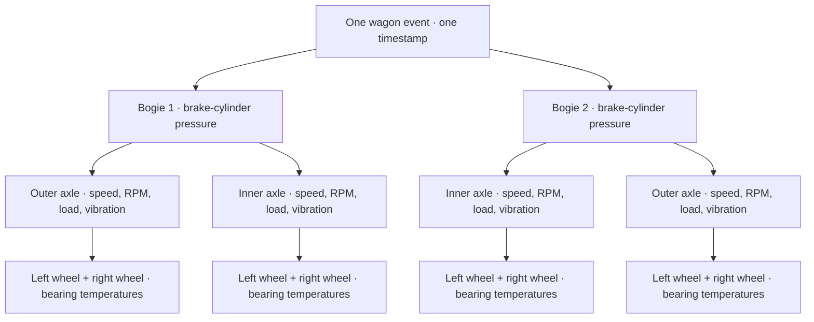
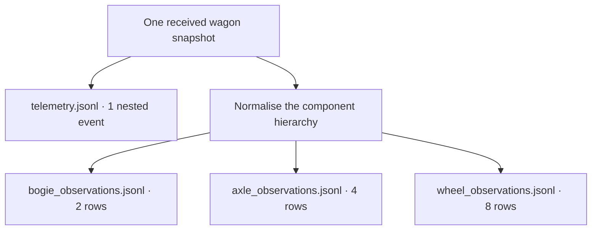

# FleetGuard AI — Data Contract 3.2

## Event grain

One `TelemetryEvent` represents one wagon at one configured sampling instant
within one journey.
It contains wagon-level readings plus nested telemetry for exactly two bogies,
two axles/wheelsets per bogie and one monitoring controller.

## One reporting snapshot: wagon → bogies → axles → wheels

At the standard **10-second sampling interval**, each wagon that is reporting
emits **one nested JSON event at each scheduled timestamp**. This is one
snapshot containing measurements for **1 wagon, 2 bogies, 4 axles and 8 wheels**,
plus its controller. The nested components belong to the same parent event and
timestamp; they are not separate times in the journey.



Wagon-level speed, location, shared brake-pipe/reservoir pressures and power
context sit at the event root. Controller diagnostics sit in `controller`.
`bogies` contains two objects; each has two `axles`; each axle has two `wheels`.
Inner/outer identifies position within a bogie; left/right identifies the wheel
within its axle. Always retain the parent identities when identifying a component.

### The same snapshot in the output files

The generator keeps the nested event and also writes normalised component rows.
These are **different representations of the same observations**, not extra
measurements taken later.



| Output | Rows per received snapshot | Identity needed |
| --- | ---: | --- |
| `telemetry.jsonl` | 1 | Event ID + wagon ID |
| `bogie_observations.jsonl` | 2 | Parent event + wagon + bogie |
| `axle_observations.jsonl` | 4 | Parent event + wagon + bogie + axle position |
| `wheel_observations.jsonl` | 8 | Parent event + wagon + bogie + axle position + wheel side |

This is **15 observation rows across the four files: 1 + 2 + 4 + 8**. The first
row already contains the nested component readings, so do not sum these files
as independent wagon reports. The controller is included in the wagon event,
not a fifth observation file. Physical properties such as wheel diameter are
stored in asset metadata and carried into the appropriate normalised output;
they are not a new measurement at every timestamp.

Ten seconds later, the next received event repeats this hierarchy with updated
readings. One healthy reporting wagon therefore normally emits **6 wagon events,
12 bogie rows, 24 axle rows and 48 wheel rows per full minute**. Sampling can also
be configured to 1 or 60 seconds.

A reporting outage emits **none of these observation rows** for its missing
scheduled snapshot. Missing-report and outage truth record the absence separately.
A failed individual sensor is different: the event can still arrive with an
unavailable measurement and its quality flag. Anomaly truth, outage truth and
asset metadata are separate from the 15 observation-row count above.

### Complete nested event example

The following is one actual healthy event produced by generator 0.4.0 with
telemetry schema 3.2. All two bogies, four axles and eight wheels are present.
Field requirements and units are detailed in the sections below and the JSON
Schemas in [contracts](contracts/README.md).

```json
{
  "signal_quality": {},
  "schema_version": "3.2",
  "event_id": "7206e51f-0444-5a03-a966-78ff7c4348e5",
  "asset_id": "FG-WGN-0002",
  "journey_id": "FG-JNY-20260101-0002",
  "route_id": "FG-RTE-CARDIFF-SWANSEA",
  "event_time": "2026-01-01T06:21:50Z",
  "generated_at": "2026-01-01T06:21:50Z",
  "sampling_interval_seconds": 10,
  "travel_direction": "reverse",
  "operating_state": "moving",
  "journey_phase": "running",
  "route_progress": 0.002214,
  "latitude": 51.626553,
  "longitude": -3.939594,
  "speed_kph": 23.413,
  "ambient_temp_c": 14.64,
  "longitudinal_acceleration_mps2": 0.13007,
  "lateral_acceleration_mps2": 0.00273,
  "vertical_acceleration_mps2": -0.02278,
  "rail_condition": "dry",
  "estimated_adhesion_coefficient": 0.2889,
  "brake_pipe_pressure_bar": 4.988,
  "auxiliary_reservoir_pressure_bar": 4.968,
  "secondary_reservoir_pressure_bar": 5.002,
  "battery_voltage_v": 4.199,
  "power_source": "axle_generators",
  "available_axle_generators": 4,
  "brake_demand": "release",
  "bogies": [
    {
      "signal_quality": {},
      "bogie_id": 1,
      "handbrake_equipped": true,
      "brake_cylinder_pressure_bar": 0.041,
      "axles": [
        {
          "signal_quality": {},
          "axle_position": "outer",
          "rotational_speed_rpm": 134.025,
          "wheel_speed_kph": 23.413,
          "axle_load_tonnes": 12.028,
          "vibration_rms_g": 0.2569,
          "wheels": [
            {
              "wheel_side": "left",
              "bearing_temp_c": 41.33
            },
            {
              "wheel_side": "right",
              "bearing_temp_c": 41.091
            }
          ]
        },
        {
          "signal_quality": {},
          "axle_position": "inner",
          "rotational_speed_rpm": 130.424,
          "wheel_speed_kph": 23.413,
          "axle_load_tonnes": 12.085,
          "vibration_rms_g": 0.2564,
          "wheels": [
            {
              "wheel_side": "left",
              "bearing_temp_c": 41.189
            },
            {
              "wheel_side": "right",
              "bearing_temp_c": 41.322
            }
          ]
        }
      ]
    },
    {
      "signal_quality": {},
      "bogie_id": 2,
      "handbrake_equipped": false,
      "brake_cylinder_pressure_bar": 0.031,
      "axles": [
        {
          "signal_quality": {},
          "axle_position": "outer",
          "rotational_speed_rpm": 136.568,
          "wheel_speed_kph": 23.413,
          "axle_load_tonnes": 12.263,
          "vibration_rms_g": 0.2595,
          "wheels": [
            {
              "wheel_side": "left",
              "bearing_temp_c": 41.115
            },
            {
              "wheel_side": "right",
              "bearing_temp_c": 41.103
            }
          ]
        },
        {
          "signal_quality": {},
          "axle_position": "inner",
          "rotational_speed_rpm": 135.536,
          "wheel_speed_kph": 23.413,
          "axle_load_tonnes": 12.247,
          "vibration_rms_g": 0.2595,
          "wheels": [
            {
              "wheel_side": "left",
              "bearing_temp_c": 41.391
            },
            {
              "wheel_side": "right",
              "bearing_temp_c": 40.958
            }
          ]
        }
      ]
    }
  ],
  "controller": {
    "temperature_c": 23.157,
    "supply_voltage_v": 25.186,
    "health_status": "healthy",
    "uptime_seconds": 1310,
    "reset_count": 0,
    "sensor_communication_error_count": 0
  }
}
```

## Physical metadata

| Scope | Fields | Character |
|---|---|---|
| Wagon | identity, fleet, age, nominal load, healthy baselines | persistent |
| Wagon battery | expected standby endurance in days | persistent |
| Bogie | identity 1/2 and handbrake-equipped flag | persistent |
| Axle/wheelset | inner/outer position within its bogie | persistent |
| Wheel | left/right side and diameter in millimetres | slowly changing |

Healthy left/right wheel diameter difference is at most 2 mm. The two wheels
share one rigid axle and therefore one measured wheelset RPM.

## Telemetry ownership

| Scope | Signals |
|---|---|
| Journey | journey ID, route ID, phase, progress |
| Wagon | GPS, speed, ambient temperature, three-axis acceleration |
| Pneumatics | brake pipe, auxiliary reservoir, secondary reservoir |
| Wagon power | `battery_voltage_v`, `power_source`, `available_axle_generators` |
| Bogie | brake-cylinder pressure |
| Wheelset | RPM, wheel speed, axle load, two bearing temperatures, vibration RMS |
| Controller | temperature, separate regulated `supply_voltage_v`, health, uptime, reset and communication counters |

All numerical units are encoded in field names. Contract ranges are synthetic
validation boundaries rather than certified railway limits.

`battery_voltage_v` is a synthetic single-cell-equivalent battery measurement
(3.0–4.2 V); it is not a measured whole-pack voltage. The controller's regulated
~25 V supply is a separate electrical rail. Each wagon has one shared battery
and four axle-end generators, one at each axle. The journey generator treats
speeds of at least 5 km/h as sufficient for generator power and charging; this
is a simulation threshold, not a manufacturer specification. While generator
power is unavailable the battery discharges at a configured rate corresponding
to a full-to-cut-off standby period of 5–7 days. Charging and discharging use
simple linear voltage approximations, not a physical state-of-charge model.

Schema 3.2 adds nullable failed speed/pressure readings with `signal_quality`,
`brake_demand`, `available_axle_generators`, missing-report truth and outage truth.
Do not mix historical 3.0/3.1 files with 3.2 without migration.
A healthy expected timestamp emits one event. A controller power outage emits
no event; it is represented on a separate expected-report truth timeline.
Multi-day parking duty planning is still outside the current journey generator.

## Quality and lineage

An omitted `signal_quality` entry means valid. A null speed or pressure requires
`missing` or `invalid` quality. Invalid raw device codes are retained only in
quality metadata, never as engineering-unit measurements. BPP/AR/SR quality
belongs to the wagon; BCP quality belongs to its bogie; speed/RPM quality belongs
to its axle. The normalised tables preserve this information.

`brake_demand` is simulated apply/release command context. `operating_state` and
route trajectory retain the planned operating context after injection; they are
not a re-simulation of vehicle dynamics under a brake fault.

One observed event joins exactly one `anomaly_truth` row using event ID and asset
ID. Missing-report truth is disjoint from observed events. For every run:
`expected_reports = telemetry_events + missing_reports`.
Each observed event still creates exactly 2 bogie, 4 axle and 8 wheel rows.
Outage intervals use `[start_time, end_time_exclusive)`. Unrecovered intervals
end at the dataset horizon. See `anomaly_catalogue.md` for timing and label rules.

## Raw versus derived values

Schema 3.2 stores simulated sensor readings and physical metadata. Feature schema 2.0 now adds valid-value mean/minimum/maximum/first/last summaries
separately at wagon, bogie, axle and wheel levels, with categorical, location,
counter and quality policies. It retains raw observations. Diameter differences,
slip ratios, pressure decay rates and other engineered residuals are not currently
implemented fields and remain potential model-development additions. Ground truth
must never enter model features. See [hierarchical feature rules](hierarchical_feature_rules.md).

## Route limitations

Generator 0.4.0 uses a bundled historical Network Rail track-level geometry
snapshot. Existing route IDs and terminal names remain; former illustrative
coordinates are snapped to mapped track vertices. Position and instantaneous
speed share an integrated, distance-based motion profile. Duration includes
simulated acceleration, cruise, braking and dwell, not a verified service timetable.

See [route source and limitations](route_data.md) and the
[current data workflow](data_workflow.md). This geometry is not
current operating authority, and the fictional terminal names do not establish
actual freight terminal access or customer operations.

## Sampling and feature windows

- 60 seconds: development and fast testing.
- 10 seconds: standard portfolio dataset and default operational journey.
- 1 second: high-resolution braking and motion experiments.
- 60 seconds: standard downstream feature-window duration.

The controller publishes one wagon-level estimated adhesion coefficient derived
from wheel, motion and braking information. Internal physical truth retains the
true adhesion coefficient and does not expose it to model inputs.

Each raw event normalises into two bogie, four axle and eight wheel observations.


## Portfolio cohort layer

Generator 0.4.0 retains schema 3.2 and existing cohort planning and saved-file
validation; feature schema remains 2.0. `cohort_plan.json` maps each unique asset to one split and run.
Each run uses the existing event/component/truth contracts. Cohort metadata is
administrative/evaluation context, not feature input. See `portfolio_dataset.md`.

## Contract reference and cross-file validation

The [signal catalogue](signal_catalogue.md) lists readable meanings, units and
contract bounds. [JSON Schema snapshots](contracts/README.md) cover the raw,
metadata, normalised, truth and component-window records. Extra fields are
forbidden by the Pydantic models; timestamps requiring offsets are checked in
Python. JSON Schema alone does not execute those custom validators.

Event identity is a UUID. Asset identity is `FG-WGN-` plus four digits. Bogie
identity is 1/2, axle identity inner/outer, and wheel identity left/right. A
component key includes its parents; axle `inner` is not unique across the wagon.
`event_time` is the source observation time; `generated_at` cannot precede it.

The generator emits the fixed two/four/eight component topology. Saved-file
validation checks projected component rows against their parent event and asset
metadata, alongside expected-grid, truth and hash consistency. The generation
guide provides [the executable workflow](dataset_generation_guide.md).

Feature windows use `[window_start, window_end)` and span 60 seconds on minute
boundaries. They expect 60/interval reports and retain component identity, split,
source event IDs, measurement quality and report completeness. Schema 2.0 numeric
summaries require all five values when valid readings exist and none when they
do not. Feature validation uses the prescribed field sets for each level.

Do not interpret schema boundaries as alert thresholds or operating limits.
