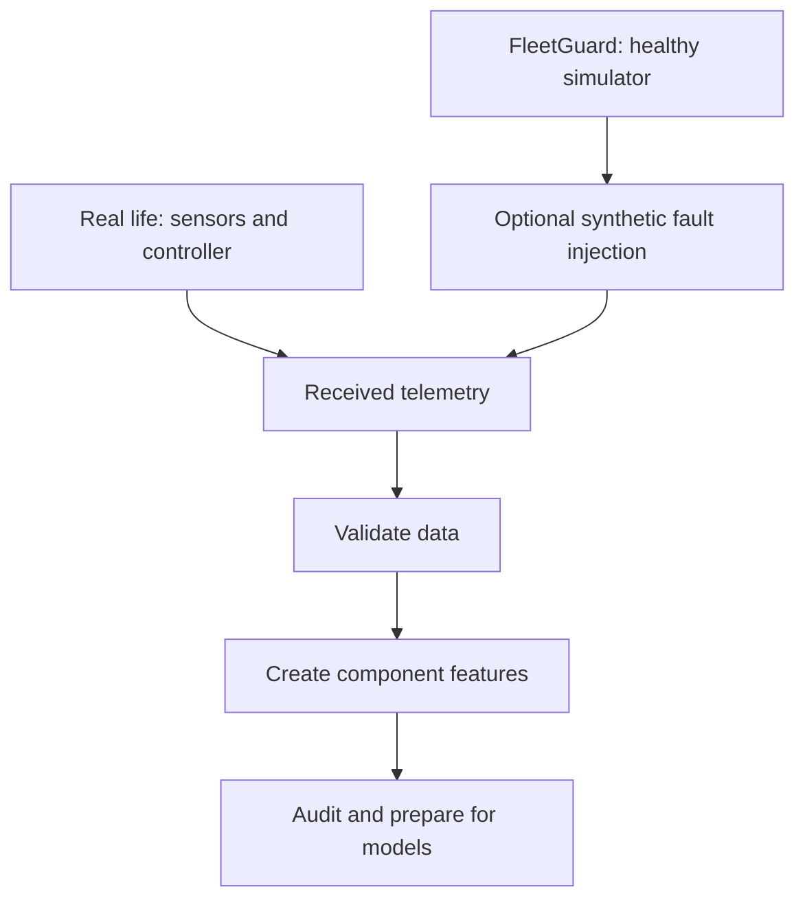
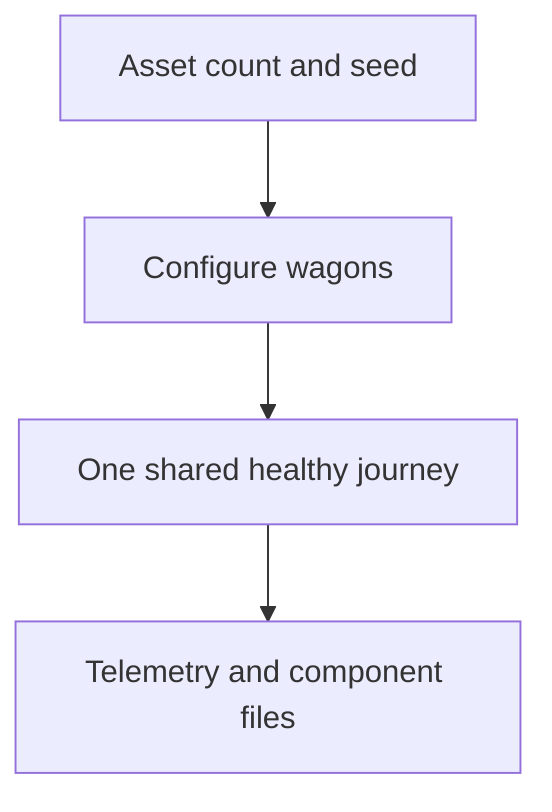
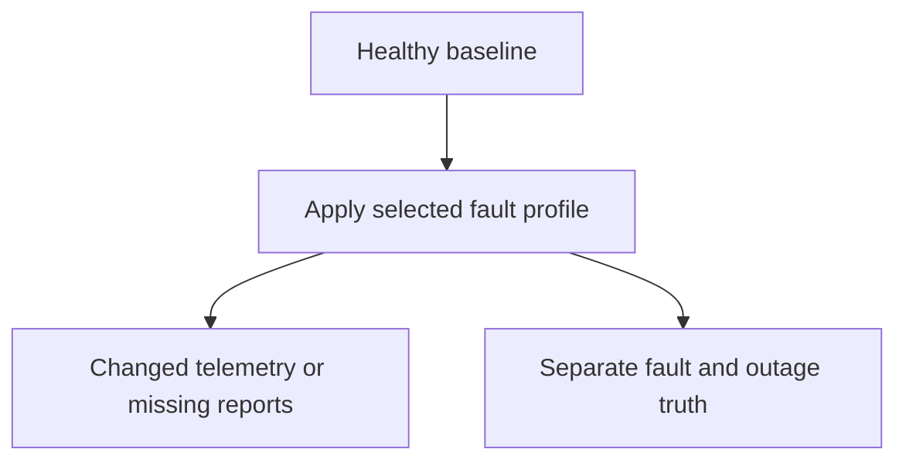
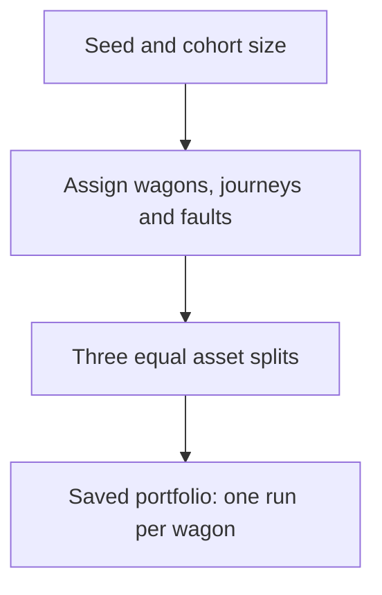
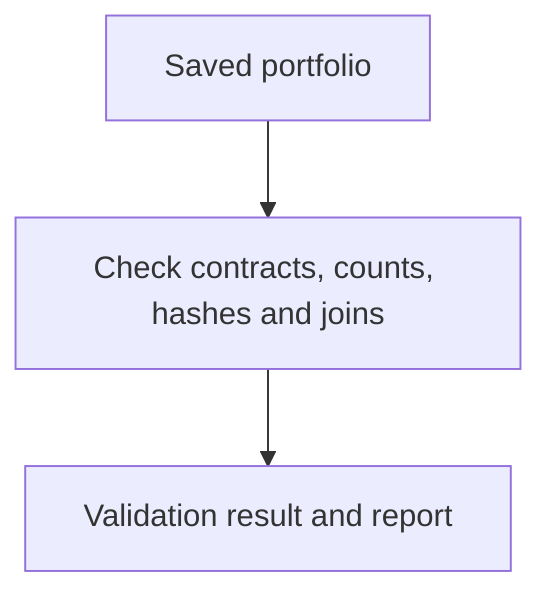
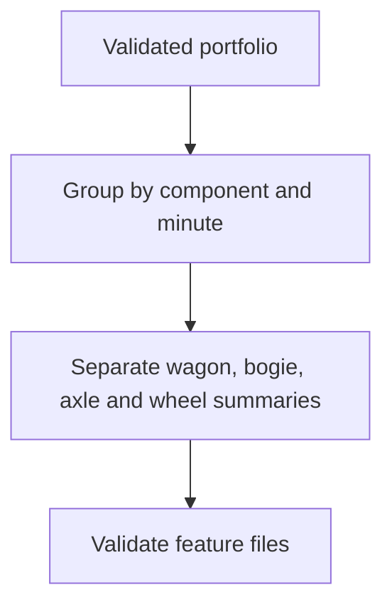
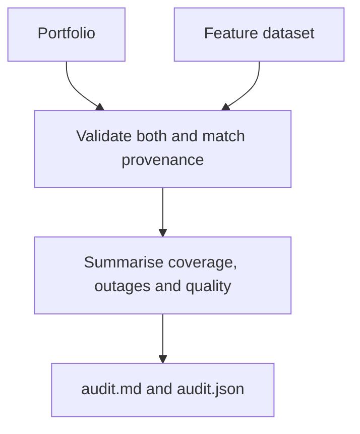

# FleetGuard — Data workflow quick guide

## Real life versus this project



**The simulator replaces the real devices as our data source.** In real life,
we would receive telemetry, validate it and create features. We built the
simulator so we can develop and test without using confidential railway data.
Its fault labels are kept separately for evaluation, never as model inputs.
The real-data path above is an illustration, not an implemented connector.

## The six parts

| # | Part | What it does |
| --- | --- | --- |
| 1 | Healthy demo generator | Creates healthy readings for a chosen number of wagons on one shared journey. |
| 2 | Anomaly demo generator | Applies one named fault profile to a generated healthy baseline. |
| 3 | Portfolio generator | Creates separate wagon duties and assigns train, validation and test splits. Default: 48 wagons. |
| 4 | Portfolio validator | Checks the saved portfolio files and their consistency. |
| 5 | Feature generator | Adds separate minute summaries for wagon, bogie, axle and wheel. Also has a feature validator. |
| 6 | Dataset auditor | Reviews portfolio coverage, reporting gaps and feature quality together. |

**Start time is an input. End time is determined by the selected journey.**
The supported routes are London–Avonmouth, Avonmouth–Cardiff, Cardiff–Swansea
and London–Swansea, including reverse direction. Coordinates follow bundled mapped
railway links. Distances drive simulated acceleration, cruising, braking and dwell;
these are not booked train schedules. See [route data](route_data.md).

Run commands in Windows CMD from your project folder with `.venv` activated.
New output directories must be empty. The current-development source and feature
dataset is named `portfolio-v1`. Generate it using the current code, then validate,
build summaries and audit it. Reuse validated outputs rather than regenerating on
every notebook run. If replacing local development data, remove the old source,
feature and audit directories together before running the workflow again.

## 1. Healthy demo



| Parameter | Supported setting |
| --- | --- |
| `--assets` | Number of wagons; default 3 |
| `--seed` | Repeatable generation; default 42 |
| `--start-time` | Required timestamp with timezone offset |
| `--sampling-interval-seconds` | 1, 10 or 60; default 10 |
| `--output-dir` | Required destination |
| `--anomaly-profile` | Defaults to `none` for healthy generation |

```cmd
python -m fleetguard.generator --assets 2 --seed 42 --start-time 2026-01-01T06:00:00+00:00 --sampling-interval-seconds 60 --output-dir data\generated\healthy-demo-02
```

One timestamp produces **one wagon event**, containing 2 bogies, 4 axles and
8 wheels. Component files contain those same readings in separate rows.
Wagons share the journey, but have different baselines and seeded variation.

## 2. Anomaly demo



Use the same parameters as section 1, plus a selected `--anomaly-profile`:

| Profile | Demonstrated fault |
| --- | --- |
| `none` | Healthy control |
| `bearing-demo` | Bearing degradation |
| `brake-leak-demo` | Brake pressure leak |
| `sensor-drift-demo` | Bearing-temperature sensor drift |
| `axle-generator-demo` | Axle speed generator failure |
| `wheel-slide-demo` | Wheel slide |
| `locked-axle-demo` | Locked axle |
| `wheel-flat-demo` | Suspected wheel flat |
| `pressure-transducer-demo` | Pressure sensor failure |
| `brake-release-demo` | Brake release failure |
| `undemanded-brake-demo` | Undemanded brake application |
| `battery-depletion-demo` | Premature battery depletion |
| `controller-persistent-demo` | Persistent controller supply failure |
| `controller-bounded-demo` | Controller outage with recovery |

```cmd
python -m fleetguard.generator --assets 2 --seed 42 --start-time 2026-01-01T06:00:00+00:00 --sampling-interval-seconds 60 --anomaly-profile brake-leak-demo --output-dir data\generated\brake-leak-demo-02
```

Demo profiles have preset targets and timing. The CLI does not take separate
fault onset, duration or component arguments. Explicit custom scenarios use the
Python API; the portfolio planner provides seeded target variation automatically.

## 3. Portfolio generation



Default: **48 wagons = 16 train + 16 validation + 16 test**.
Each split contains **13 fault variants + 3 healthy wagons**. There are 12
anomaly types; controller failure has two variants. Each faulty wagon receives
one scenario, not all thirteen. Its earlier/unaffected reports may remain healthy.

| Parameter | Supported setting |
| --- | --- |
| `--seed` | 0–2³¹−1; default 42 |
| `--start-time` | Required timezone-aware timestamp; use a minute boundary for features |
| `--sampling-interval-seconds` | 1, 10 or 60; default 10 |
| `--replicates` | Copies of each fault variant per split; 1–20, default 1 |
| `--healthy-per-split` | Healthy wagons per split; 1–100, default 3 |
| `--output-dir` | Required portfolio destination |

```cmd
python -m fleetguard.portfolio generate --seed 42 --start-time 2026-01-01T06:00:00+00:00 --sampling-interval-seconds 10 --output-dir data\generated\portfolio-v1
```

For 96 wagons, use 2 replicas and 6 healthy controls per split:

```cmd
python -m fleetguard.portfolio generate --seed 43 --start-time 2026-01-01T06:00:00+00:00 --sampling-interval-seconds 10 --replicates 2 --healthy-per-split 6 --output-dir data\generated\portfolio-96-seed43
```

**Total wagons = 3 × (13 × replicas + healthy-per-split).**
There is no portfolio `--assets`, end-time or split-count parameter.
The seed controls assignments, routes, targets and variation. Identical inputs
and code reproduce the dataset; changing cohort size can change split assignments.
Routes can repeat across wagons.

## 4. Portfolio validation



| Parameter | Supported setting |
| --- | --- |
| `--input-dir` | Required portfolio root |

```cmd
python -m fleetguard.portfolio validate --input-dir data\generated\portfolio-v1
```

Checks include component values, event/truth matching and missing-report
coverage. Refreshes `validation_report.json`. The manifest records file counts
and hashes; **the validator performs the checks**. Generation also runs validation.

## 5. Feature generation and validation



| Command | Parameters |
| --- | --- |
| `build` | Required `--input-dir` portfolio root and `--output-dir` feature destination |
| `validate` | Required `--input-dir` feature root |

```cmd
python -m fleetguard.features build --input-dir data\generated\portfolio-v1 --output-dir data\features\portfolio-v1
python -m fleetguard.features validate --input-dir data\features\portfolio-v1
```

The feature output must be outside the source dataset. The input must be a
portfolio, not a standalone demo run. Build also validates the source and output.

At 10-second sampling, each full minute expects six reports. That minute produces
**1 wagon + 2 bogie + 4 axle + 8 wheel summary rows**, each for its own component.

| Information | Minute summary |
| --- | --- |
| Numerical readings | Mean, minimum, maximum, first and last valid value; quality counts |
| States | Latest state, counts, sample fractions and observed changes |
| Coordinates | Last observed latitude/longitude pair and time |
| Controller counters | Numerical summaries plus observed increases and decreases |
| Fixed attributes | Keep known wheel diameter and handbrake flag |
| Report availability | Expected/received report counts and completeness |

Example: one bearing reports **40, 41, 42, 43, 44, 45 °C**. Its minute summary
is mean **42.5**, minimum **40**, maximum **45**, first **40**, last **45**.
This is an illustration, not an extract from the dataset. The other bearing
has its own row.

Original readings remain available. A silent minute has no measurement statistics;
missing readings are not zero. The unfinished final minute is excluded from
summaries. Files are `<split>_<level>_features.jsonl`: 3 splits × 4 levels =
12 files, plus `feature_manifest.json`. Window duration is fixed at 60 seconds.

## 6. Dataset audit



| Parameter | Supported setting |
| --- | --- |
| `--source-dir` | Required portfolio root |
| `--feature-dir` | Required matching feature root |
| `--output-dir` | Required empty destination outside both datasets |

```cmd
python -m fleetguard.audit --source-dir data\generated\portfolio-v1 --feature-dir data\features\portfolio-v1 --output-dir data\features\portfolio-v1-audit
notepad data\features\portfolio-v1-audit\audit.md
```

Shows assigned scenarios, actual routes, observed anomaly labels, missing
reports, complete/partial/silent windows and sensor quality. It does not create
labels or train a model. A received report with a failed sensor differs from
no report at all.

## Returning later: what should I run?

**If your dataset already exists, start at section 4, then validate features in
section 5 and read the existing audit. You do not need to regenerate it.**
To rerun the audit, choose a fresh output name such as `portfolio-v1-audit-02`.

The data-generation milestone is complete. The next session defines model
inputs and component/time-based evaluation labels. Truth, scenario configuration,
asset IDs and split names stay out of predictive values.

For deeper detail only when needed: [signal catalogue](signal_catalogue.md),
[anomaly catalogue](anomaly_catalogue.md), [feature rules](hierarchical_feature_rules.md)
and [full command guide](dataset_generation_guide.md).

## Run the standard workflow together

After installing the project, this CMD script runs portfolio generation, source
validation, feature generation, feature validation and audit in order. It stops
at the first failed command and never removes existing data:

```cmd
scripts\generate_portfolio.cmd
```

Use the individual commands above to change the seed, start time, sampling or
cohort size. Notebook paths already point to `portfolio-v1`.
